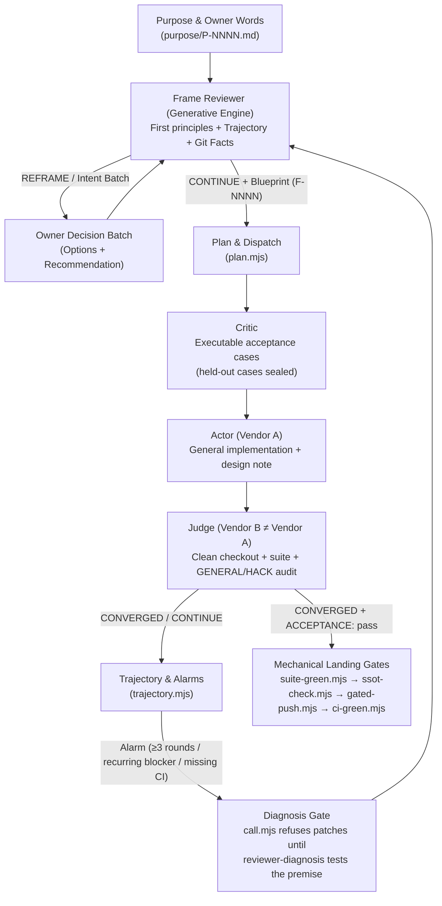

<div align="center">


# self-loop

### Turn a chaotic agent mob into a trustworthy delivery organization — so you can drink coffee at a street-side café while they ship.

<p>
  <a href="README.zh-CN.md">中文</a> · <b>English</b> · <a href="docs/getting-started.md">Getting Started</a> · <a href="docs/METHODOLOGY.md">Methodology</a> · <a href="SKILL.md">Skill Spec</a>
</p>

<sub>By <a href="https://github.com/k-r33">Ruiyuan Kang (k-r33)</a> @ <a href="https://x32studio.com">X32 Studio</a> (Kang &amp; his Agent Team) · MIT Licensed · v0.7.0</sub>

</div>

---

> **In the AI era, compute is cheap and agent instances are infinite. Human attention is your scarcest resource — and your real bottleneck.**
>
> How well you govern your agent swarm and organize it into a trustworthy delivery organization now defines your leverage.
> - **Without `self-loop`:** an ungoverned swarm is just a chaotic mob — self-grading its own homework, patching broken premises, and dragging you back into the terminal until you burn out.
> - **With `self-loop`:** your agents run as a disciplined, cross-checked organization that frames, critiques, builds, independently verifies, and ships — while you sit at a street-side café drinking coffee, stepping in only when a real strategic decision is batched for you.

Most "autonomous coding loops" in 2026 are `while true` wrappers: let an agent edit code, run unit tests, feed failures back into the prompt, and repeat until green.

On toy tasks, that works. On real software, an ungoverned agent mob fails in four predictable ways:

1. **Test-gaming & silent compromises** — an agent that grades its own homework optimizes for passing checks, not solving the requirement.
2. **Patching on a broken premise** — when two fixes fail in the same area, a retry loop adds patch #3, #4, and #5 while the underlying assumption is false.
3. **Context & document rot** — architecture notes, rationale, and "Round N" logs blur together until nobody knows what the system actually guarantees.
4. **Prose rules decay under load** — instructions written only in prompts get skipped after a few turns, dragging you back into full-time babysitting.

**`self-loop` turns chaotic coding-agent swarms (Claude Code, Codex, Antigravity, and T3 Code harnesses) into a trustworthy delivery organization.** It pairs a first-principles **Frame Reviewer** with a **cross-vendor Critic / Actor / Judge** hardening loop, trajectory-driven premise tests, SSOT authority verification, and Git-backed mechanical gates.

---

## What's New in v0.7.0

- **Bounded Horizon Window (`window.mjs`, `metrics/windows.jsonl`)** — Opens a bounded refactoring window (`horizon: 2..12`) across multi-round architectural valleys (`slack` → `converging` → `gate-due`), mechanically gating further `actor` calls (`exit 7`) until closed as `verified` (committed `CONVERGED` ruling, cross-vendor independence, exact-tree `suite-green`, and live CI) or `reframed` (post-open `reviewer-diagnosis` citing `window-horizon:<phase>:<id>`).
- **Asynchronous Periodic Outer Loop (`arch-facts.mjs`, `reviewer-architecture`, `T1`–`T4`)** — Decouples high-cadence inner delivery from periodic whole-repo architectural review (`T1` delivery cadence even on 0-bug green streaks, `T3` structural/anti-rot breach). `call.mjs` equips `reviewer-architecture` with deterministic `arch-facts.json` and a detached read-only worktree under strict `FILE_TOOLS` confinement, with mechanical `outerGrace` enforcement (`exit 7`) if ignored.
- **Deterministic Anti-Rot, Comment-Bloat & Liveness Scanners (`anti-rot.mjs`)** — Scans committed trees for compatibility/legacy remnants, dead exports, hardcoded host paths/loopback ports, skipped/todo test rot, and bulky prose code comments (enforcing doc-level SSOT over stale code comments), feeding `T3` breaches and code-to-design liveness QA + Occam reflexive audits.
- **Reliable Owner-Word Capture & Distillation Gate (`owner-words.mjs`, `reviewer-distill`, `self-loop.mjs start`)** — Filters T3/harness orchestration envelopes, probes Antigravity `hooks.json` health on `start`, and routes substantive open owner words to async `reviewer-distill` with a mechanical 1-turn grace gate (`exit 7`).

<details>
<summary>Earlier highlights in v0.6.0</summary>

- **Zero-config in-repo `.self-loop/` records (`self-loop.mjs init`)** — Initializes a nested, Git-ignored `.self-loop/` records repository inside your project (or `--local-exclude` for zero-diff `.git/info/exclude`, or external `--records <dir>`), with automatic discovery on `start`, `next`, and `stall`.
- **First-class Antigravity harness & T3 Code runner (`F-0009`)** — Full `hooks install|check|uninstall --harness antigravity`, Antigravity transcript & owner-word sync, and T3 Code child execution (`t3:claude`, `t3:codex`, `t3:antigravity`).
- **Confined `reviewer` on `t3:antigravity` & `t3:claude`** — Frame Reviewer runs natively on T3 Code (`t3:antigravity` and `t3:claude`) in addition to `claude --restricted`, backed by fail-closed transcript and relative-path confinement audits.
- **AWS CodeCommit + CodeBuild CI forge (`F-0013`)** — Unified `FORGES` dispatcher supporting both GitHub Actions (`github-actions/*`) and AWS CodeCommit / CodeBuild (`codebuild/*`) with STS caller-account binding, canonical endpoints, GRC `CODE_COMMIT_ENDPOINT` fail-closed guard, and credential redaction.
- **SSOT authority doc verification & drift gates (`F-0014`)** — `ssot-check.mjs` (`check` / `attest`) verifies bound authority documents (Rung-2 `anchors` + clean-worktree `check` scripts, Rung-3 `ssot-drift` screening & strict promotion gates) and injects a read-only `ssot-status.md` role view into `actor` and `judge` workspaces.
- **Complete `docs/` documentation suite** — Six focused guides covering Getting Started, Architecture, Concepts & Records, Harnesses, Forges & CI, and Release & Versioning.

</details>

---

## How `self-loop` Differs from Naive Agent Loops

| Dimension | Naive Retry Loops | `self-loop` |
|---|---|---|
| **Who challenges the direction?** | Only the human owner | **`Frame Reviewer`** derives architecture from purpose, trajectory & Git facts at every phase start and on alarms (`CONTINUE` or `REFRAME`) |
| **Who grades the work?** | The same model that wrote it | **Cross-vendor `Judge`** (different model vendor from `Actor`) re-runs the full suite in a clean checkout and seals its private ruling |
| **Repeated failures** | Keep patching until timeout | **Premise Gate**: `trajectory.mjs alarms` fires and `call.mjs` mechanically **refuses** new patches until `reviewer-diagnosis` tests the shared premise |
| **Authority doc drift** | Docs rot silently out of sync | **SSOT Gates (`ssot-check.mjs`)**: Rung-2 anchor & clean-worktree checks gate every push; Rung-3 drift tracks contract changes and gates promotion |
| **Rule enforcement** | Prompt instructions ("please follow...") | **5-Rung Mechanization Ladder**: construction isolation → hard Git/CI gates → screening alarms → model judgment → explicit `DEBT.md` |
| **When is a round "done"?** | Agent says "all tests pass" | **Exact-tree proof**: `suite-green.mjs` receipt for the exact Git tree + live destination `ci-green.mjs` `success` (GitHub or AWS CodeBuild) + `gated-push.mjs` |
| **Human involvement** | Continuous babysitting | **Batched owner decisions** (`decisions.mjs`) with ≥2 options & a recommendation; **human attention per verified task is the metric** |

---

## Architecture



---

## The 5-Rung Mechanization Ladder

> **Code gates over prompt obedience.** Every rule sits on the highest rung it can reach.

1. **Prevention by construction** — Role views are exported from a single records commit via allow-list (`call.mjs`). Critic and Actor physically cannot read `sealed/` or other roles' private evidence; Frame Reviewer runs confined via Claude CLI `--restricted` or audited `t3:antigravity` / `t3:claude`.
2. **Hard gates** — Deterministic scripts refuse invalid transitions (exit `2`, `6`, or `7`): `gated-push.mjs` blocks pushes without an exact-tree `suite-green.mjs` receipt, Rung-2/strict `ssot-check.mjs`, committed Judge `CONVERGED`, and live destination CI `success` on that exact SHA (`git --no-replace-objects`).
3. **Screening predicates** — `trajectory.mjs alarms`, `records-check.mjs`, and `ssot-check.mjs` detect anomalies (`area-rounds`, `blocker-recurring`, `partly-closed`, `ci-absent`, `ci-not-green`, `module-growth`, `ssot-drift`) and route them to diagnosis without brittle false kills.
4. **Model judgment** — The tool-equipped Lead model evaluates diagnoses, rulings, and next steps using verified gate outputs.
5. **Prose debt (`DEBT.md`)** — Any rule still relying on prose is logged explicitly in [`DEBT.md`](DEBT.md) and systematically moved up the ladder—every hard gate requires two-way admission evidence (turns a real defect red, keeps legitimate history green).

---

## Empirical Lessons from Production Loops

We build in the open and document what broke—not just what worked:

- **Why we deleted the v0.2 orchestrator (Lesson `L-0002`)**: `v0.2` included an 865-line autonomous state-machine orchestrator that tried to decide convergence and close rounds automatically. Two independent reviews found subtle false verdicts inside the orchestrator itself, and every patch made it worse (`550 → 865` lines). In `v0.3`, we deleted the entire orchestrator decision layer: scripts now do **only deterministic execution and factual gates**, while judgment stays with the tool-equipped Lead.
- **What a blind backtest on 12 real pivots showed**: A trajectory-reading Frame Reviewer caught **~90% of real engineering issues** (and twice spotted needed direction shifts earlier than the human owner), yet fully replicated only **~1/6 of human strategic reframes**. That is why `self-loop` never pretends humans are obsolete—it protects human attention and reserves it strictly for batched, high-leverage decisions.

---

## 5-Minute Quick Start

### 1. Prerequisites
- **Node.js >= 22** (`>= 22.13` for built-in `node:sqlite` used by Antigravity session reads; CI runs on Node 24)
- **Git**
- Optional for live CI checks & agent runs: **GitHub CLI (`gh`)**, **AWS CLI (`aws`)** (for CodeCommit + CodeBuild), and **Claude Code** / **Codex** / **Antigravity** (or **T3 Code**)

### 2. Clone & Verify the Suite
```bash
git clone https://github.com/X32Studio/self-loop.git
cd self-loop
git checkout v0.7.0
npm test
```

### 3. Run the 5-Second Mechanical Gate Demo
No API keys or network calls needed—see records validation, trajectory alarm refusal (`exit 7`), exact-tree suite receipts, and protected push gating (`exit 2`) in action:

```bash
npm run demo
```

### 4. Bootstrap a Product Loop in One Command
Initialize a nested, Git-ignored `.self-loop/` records repository inside your project (zero-config auto-discovery for `start`, `next`, and `stall`; add `--register` to register in your owner store for `gated-push.mjs` and multi-repo `tick`):

```bash
cd /path/to/your-project

# Recommended: initializes .self-loop/, updates .gitignore, and registers in ~/.self-loop/owner-store
node /path/to/self-loop/scripts/self-loop.mjs init --register

# Zero-diff option: writes .self-loop/ to .git/info/exclude instead of .gitignore
node /path/to/self-loop/scripts/self-loop.mjs init --local-exclude --register

# External records repository option
node /path/to/self-loop/scripts/self-loop.mjs init --records ../my-project-records --register
```

Then configure `.self-loop/loop.json` (see [`assets/self-loop.example.json`](assets/self-loop.example.json)), distill your requirements into `.self-loop/purpose/P-0001.md`, and run `node /path/to/self-loop/scripts/self-loop.mjs start`. See [`docs/getting-started.md`](docs/getting-started.md) for the full walkthrough.

### 5. Install as a Coding-Agent Skill
Copy the repository into your agent skills directory so Claude Code / Codex / Antigravity can run `self-loop`:

```bash
mkdir -p ~/.claude/skills
cp -r . ~/.claude/skills/self-loop
```

Configure Git hooks on any clone where you develop `self-loop`:
```bash
git config core.hooksPath .githooks
```

---

## Documentation

### Guides (`docs/`)

| Document | Contents |
|---|---|
| [`docs/getting-started.md`](docs/getting-started.md) | Prerequisites, installation, `self-loop.mjs init` (in-repo `.self-loop/`, `--local-exclude`, external `--records`), owner store registration, harness hooks, and your first full round |
| [`docs/architecture.md`](docs/architecture.md) | The 5-rung Enforcement Ladder, why v0.3 deleted the outer orchestrator, cross-vendor transcript independence, nested `.self-loop/` & `sealed/` isolation, and host capacity bounds |
| [`docs/concepts-and-records.md`](docs/concepts-and-records.md) | Tour of the records layout (`purpose`, `decisions`, `blueprint`, `design`, `plans`, `rounds`, `evidence`, `sealed`, `owner/words.jsonl`, `metrics/ssot-sync.jsonl`) and CLI reference |
| [`docs/harnesses.md`](docs/harnesses.md) | Claude Code, Codex, Antigravity, and T3 Code integration, `hooks install\|check\|uninstall`, owner-word capture/sync, confined T3 `reviewer`, and cross-vendor `observedModels` enforcement |
| [`docs/forges-and-ci.md`](docs/forges-and-ci.md) | GitHub Actions, AWS CodeCommit + CodeBuild (`F-0013`), and other Git hosts; `ci-green.mjs`, `gated-push.mjs`, GRC `CODE_COMMIT_ENDPOINT` guard, and credential redaction |
| [`docs/release-and-versioning.md`](docs/release-and-versioning.md) | `version-gate.mjs` (`tip`, `release`, `reconcile`, Git hooks), prerelease CI tips vs plain `X.Y.Z` releases, exact-tree suite caching, and multi-host release pinning |
| [`docs/METHODOLOGY.md`](docs/METHODOLOGY.md) | Deep-dive into the two engines, 5-rung ladder & Lesson `L-0002` |

### Normative Runtime Contracts

- [`SKILL.md`](SKILL.md) — Operational protocol for Lead & roles
- [`RECORDS.md`](RECORDS.md) — Managed records specification (parsed directly by `records-check.mjs`)
- [`REQUIREMENTS.md`](REQUIREMENTS.md) — Core architectural requirements
- [`DEBT.md`](DEBT.md) — Explicit register of rules not yet mechanized

---

## Repository Layout

```text
self-loop/
├── SKILL.md                 # Operational protocol for Lead & roles
├── RECORDS.md               # Managed records specification (parsed by records-check.mjs)
├── REQUIREMENTS.md          # Core architectural requirements
├── DEBT.md                  # Explicit register of rules not yet mechanized
├── docs/                    # Getting Started, Architecture, Harnesses, Forges/CI, Release, Concepts & Methodology
├── assets/                  # Role brief templates, Antigravity hooks template & example configs
├── examples/minimal-loop/   # Runnable 5-second demo of records, alarm & push gates
├── scripts/
│   ├── self-loop.mjs        # Unified entry: init, start, next, stall, tick, ssot, window, hooks, registry, heartbeat
│   ├── window.mjs           # Bounded horizon windows (open/status/close) for multi-round refactoring
│   ├── call.mjs             # Isolated role execution, SSOT/arch-facts view injection, access audit & hand-off commits
│   ├── ssot-check.mjs       # SSOT authority doc verification (Rung-2 anchors/check + Rung-3 drift & attest)
│   ├── suite-green.mjs      # Clean-worktree, exact-tree cached test receipts
│   ├── ci-green.mjs         # Live GitHub & AWS CodeBuild verification on exact push destination
│   ├── gated-push.mjs       # Protected branch push gate (suite + SSOT + judge + live destination CI)
│   ├── version-gate.mjs     # SemVer tip, pre-commit, pre-push & atomic release gates
│   ├── trajectory.mjs       # Append-only trajectory ledger & supervision alarms
│   ├── records-check.mjs    # Records layout enforcement & generated INDEX/BLUEPRINT views
│   ├── decisions.mjs        # Batched owner questions & verbatim answer events
│   ├── owner-words.mjs      # Verbatim owner directive capture (Claude/Codex/Antigravity), classification & metrics
│   ├── plan.mjs             # Parallel package validation, readiness & measurements
│   └── test/                # Deterministic unit & gate admission tests
└── acceptance/              # End-to-end process & regression acceptance suite
```

---

## Credits & License

Built by **[Ruiyuan Kang (`k-r33`)](https://github.com/k-r33)** @ **[X32 Studio](https://x32studio.com)** · Released under the [MIT License](LICENSE).
