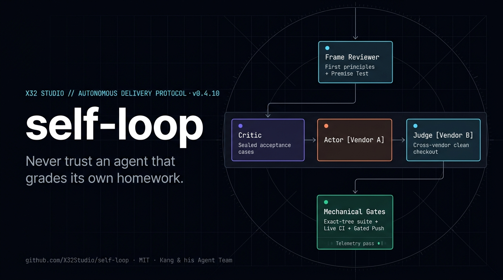
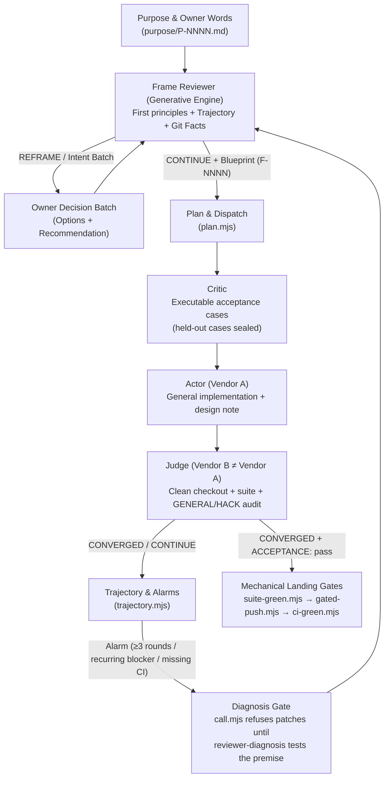

<div align="center">



# self-loop

### Ship coding-agent projects to truly done — with a fraction of your attention.

<p>
  <a href="README.zh-CN.md">中文</a> · <b>English</b> · <a href="docs/METHODOLOGY.md">Methodology</a> · <a href="SKILL.md">Skill Spec</a>
</p>

<sub>By <a href="https://github.com/k-r33">Ruiyuan Kang (k-r33)</a> @ <a href="https://x32studio.com">X32 Studio</a> (Kang &amp; his Agent Team) · MIT Licensed</sub>

</div>

---

> **Never trust an agent that grades its own homework.**

Most "autonomous coding loops" in 2026 are `while true` wrappers: let an agent edit code, run unit tests, feed failures back into the prompt, and repeat until green.

On toy tasks, that works. On real software, naive loops fail in four predictable ways:

1. **Test-gaming & silent compromises** — an agent that writes both implementation and checks optimizes for passing checks, not solving the requirement.
2. **Patching on a broken premise** — when two fixes fail in the same area, a retry loop adds patch #3, #4, and #5 while the underlying assumption is false.
3. **Context & document rot** — architecture notes, rationale, and "Round N" logs blur together until nobody knows what the system actually guarantees.
4. **Prose rules decay under load** — instructions written only in prompts get skipped after a few turns, dragging you back into full-time babysitting.

**`self-loop` is an autonomous delivery protocol for coding agents** (Claude Code, Codex, and T3/Antigravity harnesses). It pairs a first-principles **Frame Reviewer** with a **cross-vendor Critic / Actor / Judge** hardening loop, trajectory-driven premise tests, and Git-backed mechanical gates.

---

## How `self-loop` Differs from Naive Agent Loops

| Dimension | Naive Retry Loops | `self-loop` |
|---|---|---|
| **Who challenges the direction?** | Only the human owner | **`Frame Reviewer`** derives architecture from purpose, trajectory & Git facts at every phase start and on alarms (`CONTINUE` or `REFRAME`) |
| **Who grades the work?** | The same model that wrote it | **Cross-vendor `Judge`** (different model vendor from `Actor`) re-runs the full suite in a clean checkout and seals its private ruling |
| **Repeated failures** | Keep patching until timeout | **Premise Gate**: `trajectory.mjs alarms` fires and `call.mjs` mechanically **refuses** new patches until `reviewer-diagnosis` tests the shared premise |
| **Rule enforcement** | Prompt instructions ("please follow...") | **5-Rung Mechanization Ladder**: construction isolation → hard Git/CI gates → screening alarms → model judgment → explicit `DEBT.md` |
| **When is a round "done"?** | Agent says "all tests pass" | **Exact-tree proof**: `suite-green.mjs` receipt for the exact Git tree + live remote `ci-green.mjs` `success` on the pushed SHA + `gated-push.mjs` |
| **Human involvement** | Continuous babysitting | **Batched owner decisions** (`decisions.mjs`) with ≥2 options & a recommendation; **human attention per verified task is the metric** |

---

## Architecture



---

## The 5-Rung Mechanization Ladder

> **Code gates over prompt obedience.** Every rule sits on the highest rung it can reach.

1. **Prevention by construction** — Role views are exported from a single records commit via allow-list (`call.mjs`). Critic and Actor physically cannot read `sealed/` or other roles' private evidence; Claude roles run `--restricted` with no workspace auto-memory.
2. **Hard gates** — Deterministic scripts refuse invalid transitions (exit `2` or `7`): `gated-push.mjs` blocks pushes without an exact-tree `suite-green.mjs` receipt, committed Judge `CONVERGED`, and live remote CI `success` on that exact SHA (`git --no-replace-objects`).
3. **Screening predicates** — `trajectory.mjs alarms` and `records-check.mjs` detect anomalies (`area-rounds`, `blocker-recurring`, `partly-closed`, `ci-absent`, `ci-not-green`, `module-growth`) and route them to diagnosis without brittle false kills.
4. **Model judgment** — The tool-equipped Lead model evaluates diagnoses, rulings, and next steps using verified gate outputs.
5. **Prose debt (`DEBT.md`)** — Any rule still relying on prose is logged explicitly in [`DEBT.md`](DEBT.md) and systematically moved up the ladder—every hard gate requires two-way admission evidence (turns a real defect red, keeps legitimate history green).

---

## Empirical Lessons from Production Loops

We build in the open and document what broke—not just what worked:

- **Why we deleted the v0.2 orchestrator (Lesson `L-0002`)**: `v0.2` included an 865-line autonomous state-machine orchestrator that tried to decide convergence and close rounds automatically. Two independent reviews found subtle false verdicts inside the orchestrator itself, and every patch made it worse (`550 → 865` lines). In `v0.3`, we deleted the entire orchestrator decision layer: scripts now do **only deterministic execution and factual gates**, while judgment stays with the tool-equipped Lead.
- **What a blind backtest on 12 real pivots showed**: A trajectory-reading Frame Reviewer caught **~90% of real engineering issues** (and twice spotted needed direction shifts earlier than the human owner), yet fully replicated only **~1/6 of human strategic reframes**. That is why `self-loop` never pretends humans are obsolete—it protects human attention and reserves it strictly for batched, high-leverage decisions.

---

## 5-Minute Quick Start

### 1. Prerequisites
- **Node.js >= 20** (tested on Node 24 / 26)
- **Git**
- Optional for live CI checks & agent runs: **GitHub CLI (`gh`)** and **Claude Code** / **Codex** CLI

### 2. Clone & Verify the Suite
```bash
git clone https://github.com/X32Studio/self-loop.git
cd self-loop
npm test
```

### 3. Run the 5-Second Mechanical Gate Demo
No API keys or network calls needed—see records validation, trajectory alarm refusal (`exit 7`), exact-tree suite receipts, and protected push gating (`exit 2`) in action:

```bash
npm run demo
```

### 4. Install as a Coding-Agent Skill
Copy the repository into your agent skills directory so Claude Code / Codex / Antigravity can run `self-loop`:

```bash
mkdir -p ~/.claude/skills
cp -r . ~/.claude/skills/self-loop
```

Configure Git hooks on any clone where you develop `self-loop`:
```bash
git config core.hooksPath .githooks
```

### 5. Bootstrap a Product Loop
1. Create a dedicated Git records repository outside scratch space (`git init`) with `README.md` and `records.json` (see [`assets/records.example.json`](assets/records.example.json)).
2. Distill requirements into `purpose/P-0001.md`.
3. Copy [`assets/brief-*.md`](assets/) into `engines/` and configure `loop.json` from [`assets/self-loop.example.json`](assets/self-loop.example.json) (set different vendors for `judge` and `actor`).
4. Register the product and start:
   ```bash
   node scripts/self-loop.mjs registry init
   node scripts/self-loop.mjs registry add --name my-app --records /abs/path/to/my-app-records
   node scripts/self-loop.mjs start
   ```

---

## Repository Layout

```text
self-loop/
├── SKILL.md                 # Operational protocol for Lead & roles
├── docs/METHODOLOGY.md      # Deep-dive into the two engines, 5-rung ladder & L-0002
├── RECORDS.md               # Managed records specification (parsed by records-check.mjs)
├── REQUIREMENTS.md          # Core architectural requirements
├── DEBT.md                  # Explicit register of rules not yet mechanized
├── assets/                  # Role brief templates, owner batch templates & example configs
├── examples/minimal-loop/   # Runnable 5-second demo of records, alarm & push gates
├── scripts/
│   ├── self-loop.mjs        # Unified entry: start, next, stall, tick, registry, heartbeat
│   ├── call.mjs             # Isolated role execution, access audit & hand-off commits
│   ├── suite-green.mjs      # Clean-worktree, exact-tree cached test receipts
│   ├── ci-green.mjs         # Live GitHub check-run verification on exact push destination
│   ├── gated-push.mjs       # Protected branch push gate (suite + judge + live CI)
│   ├── version-gate.mjs     # SemVer tip, pre-commit, pre-push & atomic release gates
│   ├── trajectory.mjs       # Append-only trajectory ledger & supervision alarms
│   ├── records-check.mjs    # Records layout enforcement & generated INDEX/BLUEPRINT views
│   ├── decisions.mjs        # Batched owner questions & verbatim answer events
│   ├── owner-words.mjs      # Verbatim owner directive capture, classification & metrics
│   ├── plan.mjs             # Parallel package validation, readiness & measurements
│   └── test/                # Deterministic unit & gate admission tests
└── acceptance/              # End-to-end process & regression acceptance suite
```

---

## Credits & License

Built by **[Ruiyuan Kang (`k-r33`)](https://github.com/k-r33)** @ **[X32 Studio](https://x32studio.com)** · Released under the [MIT License](LICENSE).
