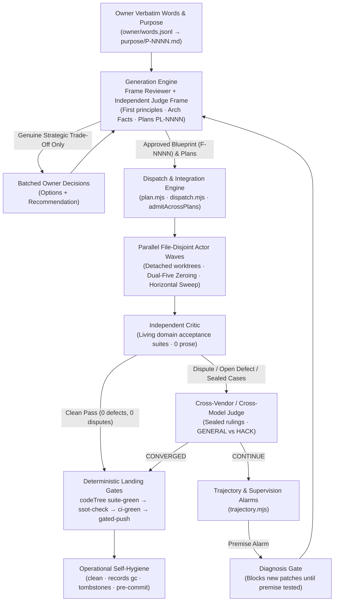

<div align="center">


# self-loop

### The deterministic delivery control plane for coding-agent swarms.

**AI coding doesn't fail on intelligence — it fails on verification, organization, and long-horizon entropy.**
`self-loop` turns any coding agent (Claude Code, Codex, Antigravity, Paseo, T3) into a parallel, self-verifying delivery organization backed by zero-dependency Git & CLI truth gates — spending human attention only on decisions only a human can make.

<p>
  <b>English</b> · <a href="README.zh-CN.md">中文</a> · <a href="docs/getting-started.md">Getting Started</a> · <a href="docs/architecture.md">Architecture</a> · <a href="docs/METHODOLOGY.md">Methodology</a> · <a href="SKILL.md">Skill Spec</a>
</p>

<sub>By <a href="https://x32studio.com">X32 Studio</a> · MIT Licensed · Zero Dependencies (Node.js &gt;= 22 + Git) · v0.9.10</sub>

</div>

---

## The Problem: Why Long-Horizon Agent Loops Collapse

Running a coding agent for 3 turns is easy. Running a swarm of agents for **50–80 rounds** on a real codebase fails in five predictable ways:

1. **Self-grading & silent shortcuts** — an agent that reviews its own diff optimizes for turning tests green, not satisfying the requirement.
2. **Patching on a broken premise** — when two attempts fail in the same module, naive retry loops stack patch #3, #4, and #5 instead of questioning the assumption.
3. **Serial bottlenecks & weaponized ceremony** — orthogonal tracks sit idle waiting on Track 1, or heavy multi-agent workflows waste tokens running redundant review layers on trivial, undisputed changes.
4. **Attention burn** — agents constantly interrupt the human owner for facts that code, Git history, or first-principles reasoning can already answer.
5. **Round-80 operational entropy** — by round 50+, unmanaged loops choke on their own exhaust: multi-megabyte audit logs, thousands of stale evidence artifacts, drifting indexes, stray untracked drafts, and minute-long startup stalls.

**`self-loop` treats human attention per verified task as the primary engineering metric.** Instead of another black-box prompt wrapper, it is a **zero-dependency control plane** that isolates roles, enforces factual claims in code, and lets any model/harness do the thinking.

---

## Core Thesis: Four Pillars of `self-loop`

### 1. Attention-Budget Engineering (Generation-Engine-First)
Human attention is the scarcest resource in AI engineering. Before escalating a single question to the owner, `self-loop` distills verbatim owner intent into `purpose/P-NNNN.md` and runs a **Frame Reviewer + independent derivation review** against the codebase and Git history. Only genuine owner-only strategic trade-offs reach the human — batched with concrete options and a recommendation (`decisions.mjs`).

### 2. Parallel-First Delivery Without Weaponized Ceremony
- **Parallel Actor Waves (`plan.mjs`, `dispatch.mjs`)**: Decoupled features split automatically into file-disjoint parallel Actor packages reconciled across all active plans (`admitAcrossPlans`), with conflict-free wave integration.
- **Dual-Five Zeroing (`SKILL.md`)**: Every fix pinpoints root cause, reproduces deterministically, verifies cleanly, and performs a mandatory **whole-repo horizontal grep sweep** so sibling consumers and state machines sharing the same bug are fixed in the same wave — then feeds management lessons back into briefs and gates.
- **Zero-Waste Convergence**: When an independent Critic passes with zero open defects, zero disputes, and zero audit violations, the wave **converges directly without a redundant Judge**. The cross-vendor/cross-model **Judge** is reserved for real disputes, held-out `sealed/` verification, and derivation rulings.
- **Multi-Core Parallel Suites, Per-File `--relay` & `codeTree` Reuse (`suite-green.mjs`)**: Runs test files concurrently across CPU cores, caches per-file checkpoints by content hash so reruns only execute failed/changed files (macOS 132/133 relay finish in `17s`), and reuses exact `(codeTree, runtime)` receipts across `VERSION`-only release tips (`~11s` CI).
- **Atomic Isolated-Worktree Lead Patches (`self-loop.mjs patch --diff`)**: Bounded Lead micro-fixes (`<= 20` lines, `<= 3` files) apply unified diffs in a clean temporary worktree, run mandatory `--verify`, and fast-forward land — zero unverified edits in the main checkout.

### 3. Code Gates Over Prompt Obedience (The 5-Rung Enforcement Ladder)
Prompts decay under context load. Every rule in `self-loop` lives on the highest mechanical rung it can earn — and **scripts never substitute for engineering judgment** (see [Lesson `L-0002`](#empirical-lessons-from-production-loops)):

1. **Prevention by construction** — Roles execute in detached Git worktrees with allow-listed read-only record views exported from a single commit. Non-judges physically cannot see `sealed/` held-out cases or private judge rulings.
2. **Hard gates** — Deterministic scripts refuse invalid transitions (exit `2`, `6`, `7`) using `git --no-replace-objects`: exact-tree `suite-green`, live destination `ci-green` (GitHub Actions or AWS CodeBuild), commit-graph provenance (`gated-push`), SemVer `VERSION`/tag atomicity (`version-gate`), deterministic 15-language zero-prose-comment lexing, and SSOT authority checks (`ssot-check`).
3. **Screening & alarms** — Non-blocking supervision (`area-rounds`, `blocker-recurring`, `ci-not-green`, `arch-facts` anti-rot, host capacity bounds) triggers mandatory premise-testing diagnosis before stacking blind patches.
4. **Model judgment** — Tool-using agents (Lead, Frame Reviewer, Critic, Actor, Judge) make every real design and engineering call from verified gate outputs.
5. **Prose debt (`DEBT.md`)** — Any rule still relying on prose is tracked explicitly as debt and mechanized only when proven with two-way evidence (red on real defects, zero false kills on legitimate history).

### 4. Built for Round 80, Not Just Round 1 (Operational Self-Hygiene)
Forged across 55–80+ round production loops on real multi-repo codebases:
- **Bounded Audits (`<= 1 MiB`)**: Per-command deduplication and preview truncation prevent quadratic audit JSON blowups while preserving all Tier-0 security flags.
- **Self-Healing Cleanup & Cryptographic Tombstones (`self-loop.mjs clean` / `records gc`)**: Reclaims finished worktrees, prunes LRU suite caches, compacts oversized logs/audits, and prunes uncited historical evidence while recording SHA-256 + origin-commit tombstones (`prune/PR-NNNN.md`) that keep citation integrity verifiable.
- **Shared In-Memory Commit DAG & Batched Git Snapshots (`scripts/lib/dag.mjs`)**: Loads commit ancestry once per repo and batches Git object/log reads, eliminating `O(N)` subprocess storms across `provenance`, `dispatch`, `plan`, `ci`, and `gated-push` (`>3m → 12.5s` on 57-round histories).
- **Persistent Engineering Experience & Technical Option Blacklist (`EXPERIENCE.md`)**: Codifies recurring low-level failure classes (`TB-01`–`TB-10`, Forbidden Naive Option → Mandatory Better Option → Enforcement Rung) directly into `SKILL.md` and Actor/Critic/Frame-Reviewer briefs so hard-won lessons compound instead of repeating.
- **Portable Records `pre-commit` Guard**: `self-loop.mjs init` and `hooks install --records` install a secret-free `.githooks/pre-commit` that blocks undeclared stray files and `INDEX.md`/`BLUEPRINT.md` drift before commit.
- **Zero Model or Harness Lock-In**: Configure any `runner` (`paseo`, `t3`, `claude`, `codex`), `provider` (`better-paseo-antigravity`, `antigravity`, `claude`, `codex`, `cursor`, `opencode`, `pi`, or custom plugins), `adapter`, router-prefixed models, and independence policy (`vendor` | `model` | `session`) in `loop.json`.

---

## Architecture



### How It Compares

| Dimension | Naive Retry / Prompt Loops | Heavy Black-Box Frameworks | `self-loop` |
|---|---|---|---|
| **Who makes decisions?** | Unchecked single loop | Hard-coded state-machine orchestrator | **Tool-using LLM roles** reading deterministic Git/CLI gate outputs |
| **Parallelism** | Serial one-task-at-a-time | Ad-hoc sub-agents with merge conflicts | **File-disjoint Actor waves** reconciled across plans + deterministic integration |
| **Verification** | Self-graded ("tests look good") | Prompt-based self-review | **Independent Critic (direct pass on zero disputes)** + **Cross-vendor/model Judge** on disputes |
| **Repeated failures** | Patch #3, #4, #5 blindly | Retry until max-iter timeout | **Premise Gate** mechanically blocks new patches until `reviewer-diagnosis` tests the assumption |
| **Long-horizon hygiene** | Context & repo bloat over time | Logs pile up untracked | **Bounded `<= 1 MiB` audits, tombstone GC, portable `.githooks/pre-commit`** |
| **Dependencies & lock-in** | Heavy SDKs / single vendor | Proprietary runtime | **Zero `npm` dependencies** (Node.js >= 22 + Git); any runner, model, or GitHub/CodeBuild forge |

---

## Empirical Lessons from Production Loops

We build in the open and document what broke — not just what worked:

- **Why we deleted our own v0.2 orchestrator (Lesson `L-0002`)**: `v0.2` included an 865-line autonomous state-machine orchestrator that tried to decide convergence and close rounds automatically. Independent reviews uncovered subtle false verdicts inside the orchestrator itself, and every patch worsened complexity (`550 → 865` lines). In `v0.3`, we deleted the entire deciding orchestrator: **scripts enforce isolation and factual gates; judgment belongs to tool-equipped models and humans.**
- **Blind backtest on 12 real project pivots**: A trajectory-reading Frame Reviewer caught **~90% of real engineering issues** (twice spotting needed direction shifts earlier than the owner), yet replicated only **~1/6 of human strategic reframes**. That is why `self-loop` never pretends humans are obsolete — it protects human attention strictly for high-leverage calls.
- **Complementary to craft skills**: Lightweight coding skills (such as seam-first TDD, deep-module design, and domain glossaries) teach agents *how to write clean code inside a task*; `self-loop` governs *multi-agent boundaries, independent verification, and Git-backed delivery truth across dozens of rounds*.

---

## Quick Start (3 Minutes)

### 1. Prerequisites
- **Node.js `>= 22`** (`>= 22.13` for built-in `node:sqlite`; CI verified on Node 24) and **Git** — **zero `npm install` required**.
- Optional: `gh` (GitHub Actions), `aws` (AWS CodeCommit + CodeBuild), and your preferred agent harness (`paseo`, `antigravity`, `claude`, `codex`, or `t3`).

### 2. Clone & Run the 5-Second Mechanical Gate Demo
No API keys or network calls needed — watch records validation, trajectory alarm refusal (`exit 7`), exact-tree suite receipts, and protected push gating (`exit 2`) live:

```bash
git clone https://github.com/X32Studio/self-loop.git ~/tools/self-loop
cd ~/tools/self-loop
git checkout v0.9.10
npm run demo
```

### 3. Initialize a Loop in Your Project
`self-loop` defaults to a nested, Git-ignored `.self-loop/` records repo inside your project (with automatic portable `.githooks/pre-commit` protection):

```bash
cd /path/to/your-project

# Standard setup (creates .self-loop/, updates .gitignore, registers in ~/.self-loop/owner-store)
node ~/tools/self-loop/scripts/self-loop.mjs init --register

# Parameterized multi-harness / model setup (e.g. Paseo + model independence)
node ~/tools/self-loop/scripts/self-loop.mjs init --register \
  --harness paseo --runner paseo --provider better-paseo-antigravity \
  --independence model

# Zero-diff option (writes .self-loop/ to .git/info/exclude instead of tracked .gitignore)
node ~/tools/self-loop/scripts/self-loop.mjs init --local-exclude --register
```

### 4. Install as a Coding-Agent Skill & Enable Harness Hooks

```bash
# Link into your agent skills directory (Antigravity / Claude Code / Codex / Paseo)
ln -s ~/tools/self-loop ~/.agents/skills/self-loop
# or: cp -r ~/tools/self-loop ~/.claude/skills/self-loop

# Optional: install Antigravity PreToolUse / owner-word / Stop hooks
node ~/tools/self-loop/scripts/self-loop.mjs hooks install --harness antigravity
node ~/tools/self-loop/scripts/self-loop.mjs hooks check --harness antigravity
```

Then write your phase purpose in `.self-loop/purpose/P-0001.md` and run:

```bash
node ~/tools/self-loop/scripts/self-loop.mjs start
```

### 5. Keep Long-Running Loops Clean

```bash
# Preview and reclaim finished worktrees, stale suite caches, oversized audits, and uncited old evidence
node ~/tools/self-loop/scripts/self-loop.mjs clean --config .self-loop/loop.json --dry-run
node ~/tools/self-loop/scripts/self-loop.mjs clean --config .self-loop/loop.json --apply
```

---

## When to Use `self-loop` — and When Not To

- **Use `self-loop` when**:
  - You are shipping a multi-day or multi-week codebase with parallel feature tracks and real invariants.
  - You want cryptographic/Git proof that every protected-branch merge was tested on its exact commit tree and verified independently.
  - You run coding agents across 10–80+ rounds and want zero document rot, zero self-grading, and minimal human babysitting.
- **Do NOT use `self-loop` for**:
  - One-off Q&A, throwaway scripts, or quick exploratory prototypes that need no durable records or adversarial verification.

---

## Documentation & Contracts

| Document | Purpose |
|---|---|
| [`SKILL.md`](SKILL.md) | Executable operating protocol for the Lead agent (Steps 0–5, Dual-Five Zeroing, Pre-Idle Anti-Serial Check, Before-You-Claim Gate Table) |
| [`assets/reference-cli-and-gates.md`](assets/reference-cli-and-gates.md) | Complete CLI flag reference, JSON schemas, dispatch gates, and adapter protocols |
| [`docs/getting-started.md`](docs/getting-started.md) | Step-by-step walkthrough from `init` to protected-branch promotion |
| [`docs/architecture.md`](docs/architecture.md) | The 5-rung Enforcement Ladder, isolated role views, `sealed/` confinement, and zero-dependency design |
| [`docs/harnesses.md`](docs/harnesses.md) | Paseo, Antigravity, Claude Code, Codex, and T3 integration, hooks, and transcript-verified independence |
| [`docs/forges-and-ci.md`](docs/forges-and-ci.md) | GitHub Actions, AWS CodeCommit + CodeBuild, and generic Git host integration |
| [`docs/release-and-versioning.md`](docs/release-and-versioning.md) | SemVer `VERSION`-only tips, `codeTree` suite caching, atomic tags, and dual-platform CI |
| [`docs/concepts-and-records.md`](docs/concepts-and-records.md) | Records layout (`purpose`, `decisions`, `blueprint`, `plans`, `rounds`, `evidence`, `prune`, `sealed`) |
| [`docs/METHODOLOGY.md`](docs/METHODOLOGY.md) | Deep dive into the engines, Enforcement Ladder, and Lesson `L-0002` |
| [`EXPERIENCE.md`](EXPERIENCE.md) | Persistent engineering experience & Technical Option Blacklist (`TB-01`–`TB-10`) enforced across Actors, Critics, and Frame Reviewers |
| [`GLOSSARY.md`](GLOSSARY.md) | Canonical domain glossary preventing terminology drift across briefs, records, and gates |
| [`RECORDS.md`](RECORDS.md) / [`REQUIREMENTS.md`](REQUIREMENTS.md) / [`DEBT.md`](DEBT.md) | Normative runtime contracts parsed by gates and explicit mechanization debt ledger |

---

## Repository Layout

```text
self-loop/
├── SKILL.md                 # Lead agent operating procedure
├── EXPERIENCE.md            # Persistent engineering experience & Technical Option Blacklist (TB-01..TB-10)
├── GLOSSARY.md              # Canonical domain glossary
├── RECORDS.md               # Normative records schema (parsed by records-check.mjs)
├── REQUIREMENTS.md          # First-principles requirements & rationale
├── DEBT.md                  # Explicit ledger of prose rules yet to be mechanized
├── docs/                    # Architecture, Getting Started, Harnesses, Forges/CI, Releases & Methodology
├── assets/                  # Role brief templates, CLI reference, hook templates & example configs
├── examples/minimal-loop/   # Runnable 5-second zero-API demo of deterministic gates
├── scripts/
│   ├── self-loop.mjs        # Unified entry: init, start, next, stall, tick, clean, prune, records, dispatch, patch, ssot, window, hooks, registry, heartbeat
│   ├── call.mjs             # Isolated worktree/view runner, access audit (<= 1 MiB), comment gate & atomic hand-off
│   ├── dispatch.mjs         # Coupling analysis, parallel Actor/Critic waves & wave integration
│   ├── plan.mjs             # Multi-plan validation, cross-plan admission & time-budget readiness
│   ├── lead-patch.mjs       # Bounded Lead micro-patches (--diff in isolated worktree, <= 20 lines, <= 3 files, mandatory --verify)
│   ├── suite-green.mjs      # Clean-worktree, parallel per-file --relay & exact-codeTree cached full-suite receipts
│   ├── ci-green.mjs         # Live GitHub Actions & AWS CodeBuild check verification
│   ├── gated-push.mjs       # Protected branch push gate (suite + provenance + independent convergence + live CI)
│   ├── version-gate.mjs     # SemVer tips, pre-commit/pre-push hooks & atomic branch+tag release
│   ├── ssot-check.mjs       # Bound authority-doc anchors & drift gates
│   ├── bench-gate.mjs       # Paired clean-worktree statistical latency gate
│   ├── trajectory.mjs       # Append-only trajectory ledger & premise-testing alarms
│   ├── records-check.mjs    # Records integrity, --staged pre-commit check, --prune tombstones & INDEX/BLUEPRINT sync
│   ├── decisions.mjs        # Generation-Engine-first batched owner decisions & verbatim answers
│   ├── owner-words.mjs      # Verbatim owner directive capture, envelope filtering, batch mark & settlement
│   └── test/                # Deterministic unit & gate tests
└── acceptance/              # End-to-end process, hygiene & regression acceptance suites
```

---

## Running Tests

```bash
npm test                 # Unit & gate suite
npm run test:acceptance  # End-to-end acceptance suite
npm run test:all         # Full suite
```

---

## Credits & License

Built by **[X32 Studio](https://x32studio.com)** · Released under the [MIT License](LICENSE).
