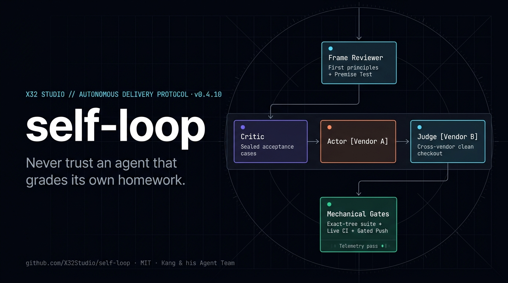

<div align="center">



# self-loop

### 把混乱的 Agent 乌合之众，整编为可信赖、能直接交付的 Agent 组织——把注意力还给人，让你在街边喝咖啡时它们照常交付。

<p>
  <b>中文</b> · <a href="README.md">English</a> · <a href="docs/METHODOLOGY.md">Methodology</a> · <a href="SKILL.md">Skill Spec</a>
</p>

<sub>作者：<a href="https://github.com/k-r33">Ruiyuan Kang (k-r33)</a> @ <a href="https://x32studio.com">X32 Studio</a>（Kang 和他的 Agent 团队） · MIT 协议</sub>

</div>

---

> **在 AI 时代，算力和 Agent 实例可以无限复制，人最宝贵、也最大的瓶颈是 Attention（注意力）。**
>
> 能否管控好自己的 Agent Swarm、把它们整编成真正可信赖的交付组织，直接决定了不同人的能力上限：
> - **没有 `self-loop`：** 一群缺乏治理的 Agent 只是混乱的**乌合之众**——自己给自己批作业、在错误前提上死打补丁、上下文腐败；你被迫全程盯盘、在混乱中疲于奔命直到精疲力尽。
> - **有了 `self-loop`：** 你可以直接坐在**街边喝咖啡**，让你的 Agent 组织（第一性帧评审 + 跨厂商 Critic / Actor / Judge 独立验收 + 前提审计硬门禁）自主推进并直接交付——只在真正需要人类战略拍板时，才把带推荐答案的选项打包交给你。

2026 年市面上的大多数 "agent loop"，本质上都是一个 `while true` 外壳：让模型改代码、跑单测、把报错塞回上下文，直到返回 0。

在玩具任务上这能跑通；但在真实工程里，缺乏组织治理的 Agent 乌合之众会以 4 种可预测的方式失控：

1. **糊弄验收**：写实现和写检查的是同一个模型，它天然倾向于修改测试或绕开约束来凑绿灯。
2. **在错误前提上死打补丁**：同一处问题连续修两次都失败，重试循环只会打出第 3、4、5 个补丁，把代码越改越烂。
3. **文档与上下文腐败**：架构设计、历史轮次记录和临时结论混在一起，几轮之后没人知道系统到底保证了什么。
4. **提示词约束必然衰减**：只写在 Prompt 里的规矩过几轮就会被遗忘，最后还是把人绑回屏幕前当全职监工。

**`self-loop` 把混乱的 Coding Agent 群落（Claude Code / Codex / T3 等）整编成可信赖、能直接交付的 Agent 组织**：它把**第一性帧评审**、**跨厂商对抗裁判**、**轨迹报警前提审计**与 **Git 代码门禁**拧成闭环。

---

## 核心差异：为什么不是又一个重试脚本

| 维度 | 传统重试循环 | `self-loop` |
|---|---|---|
| **谁来质疑方向？** | 只能靠人 | **`Frame Reviewer`（第一性评审员）**：每阶段开始与报警触发时，从目的、轨迹与 Git 事实推导方案，可直接给出 `REFRAME` |
| **谁来裁定完成？** | 自己判自己 | **跨厂商独立裁判（`Judge`）**：强制与 `Actor` 使用不同厂商模型，在干净检出上复跑全套测试并封存完整裁定 |
| **连续失败怎么处理？** | 继续打补丁直到超时 | **前提审计门禁**：`trajectory.mjs alarms` 触发后，`call.mjs` 直接**拒绝**后续修复调用，直到记录 `PREMISE` + 可证伪的 `OBSERVATION` |
| **规矩靠什么保证？** | Prompt 叮嘱 | **5 级机械化阶梯**：物理构造隔离 → 硬门禁 → 轨迹筛查 → 模型判断 → `DEBT.md` 显式欠账 |
| **何时算真正关闭？** | 模型口头汇报 "All green" | **精确树证明**：`suite-green.mjs` 精确 Git 树回执 + `ci-green.mjs` 远端推送目标真实 CI `success` + `gated-push.mjs` |
| **人的注意力花在哪？** | 全程盯着防止跑偏 | **带推荐答案的小批次决策**：以「每个经核实任务消耗的人工分钟数」为核心指标 |

---

## 5 级机械化阶梯（能用代码约束的，绝不靠模型自觉）

1. **构造隔离（做不到）**：每个角色的工作视图由 `call.mjs` 从某个精确提交按白名单导出，Critic/Actor 物理上根本看不到 `sealed/`；Claude 角色以 `--restricted` 运行，不加载项目记忆。
2. **硬门禁（确定性拒绝）**：`gated-push.mjs` 在推送前核对精确 Git 树测试回执、已提交的裁判 `CONVERGED` 与推送目的仓库的实时 CI，任一缺失直接退出码 `2`。
3. **筛查报警（路由诊断）**：`trajectory.mjs alarms` 监控同一区域多轮停滞、同类阻断反复、CI 缺失与模块膨胀，只报事实与证据，不无故误杀。
4. **模型判断**：由带工具的 Lead 模型结合门禁证据做决策。
5. **文字欠账（`DEBT.md`）**：所有暂未代码化的规则公开登记在 [`DEBT.md`](DEBT.md)，每个阶段持续向高阶梯迁移。

---

## 公开复盘：工程诚实胜过神话叙事

- **为什么我们在 v0.3 亲手删掉了整个自动编排层（教训 `L-0002`）**：v0.2 曾写了 865 行编排器状态机去自动判断收敛和关轮，两轮独立评审都在里面抓出误判，越补越复杂。于是在 v0.3 整层删除，脚本只做**确定的隔离调用与事实门禁**，判断还给带工具的 Lead。
- **12 个真实历史拐点的盲测回放**：能看到轨迹的评审员抓出了 **~90% 的真实工程问题**，但只能完全复现约 **1/6 的人类方向重构**。因此 `self-loop` 不吹嘘“零人工全自动”，而是把人的稀缺注意力精准收束到最高杠杆的方向拍板上。

---

## 5 分钟快速上手

```bash
# 1. 克隆并运行完整单元测试
git clone https://github.com/X32Studio/self-loop.git
cd self-loop
npm test

# 2. 运行 5 秒门禁体验 Demo（无需 API Key / 联网）
# 直观体验：记录校验 → 触发报警后 call.mjs 拒绝继续打补丁（exit 7）→ 精确树测试回执 → 受保护推送拒绝（exit 2）
npm run demo
```

安装为 Claude Code / Agent 技能：
```bash
mkdir -p ~/.claude/skills
cp -r . ~/.claude/skills/self-loop
```

详细操作协议见 [`SKILL.md`](SKILL.md)，记录规范见 [`RECORDS.md`](RECORDS.md)，方法论深挖见 [`docs/METHODOLOGY.md`](docs/METHODOLOGY.md)。

---

## 作者与开源协议

由 **[Ruiyuan Kang (`k-r33`)](https://github.com/k-r33)** @ **[X32 Studio](https://x32studio.com)** 建造 · 基于 [MIT License](LICENSE) 开源。
