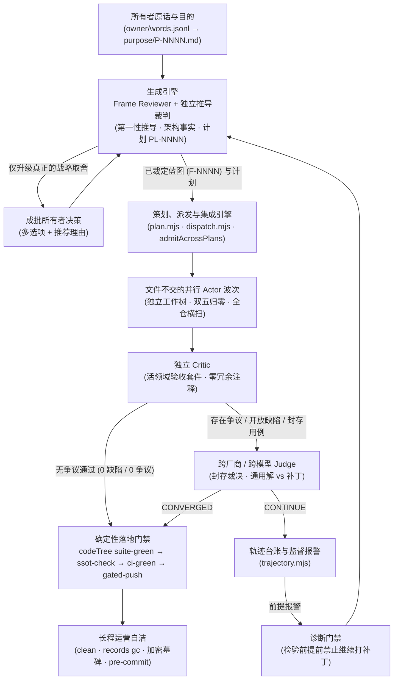

<div align="center">


# self-loop

### 面向编程 Agent 集群的确定性交付控制面

**AI 写代码失败的从来不是智商，而是验证失真、组织失序与长程熵增。**
`self-loop` 用零依赖的 Git 与 CLI 物理门禁，将任意编程 Agent（Claude Code、Codex、Antigravity、Paseo、T3）编排成并行推进、独立验真、长期自洁的工程交付组织——把最稀缺的人类注意力，只留给只有人能拍板的战略取舍。

<p>
  <a href="README.md">English</a> · <b>中文</b> · <a href="docs/getting-started.md">快速开始</a> · <a href="docs/architecture.md">架构设计</a> · <a href="docs/METHODOLOGY.md">方法论</a> · <a href="SKILL.md">Skill 规范</a>
</p>

<sub>由 <a href="https://x32studio.com">X32 Studio</a> 构建 · MIT 协议 · 零外部依赖（Node.js &gt;= 22 + Git）· v0.9.10</sub>

</div>

---

## 问题本质：为什么长程 Agent 循环总会失控？

让一个编程 Agent 跑 3 轮很容易；让一群 Agent 在真实代码库上连续跑 **50–80 轮**，几乎必然撞上五类系统性失败：

1. **自写自审与静默妥协** — 自己批改自己作业的 Agent，优化目标是“把测试糊弄绿”，而不是真正满足需求。
2. **在错误前提上叠补丁** — 同一模块连改两次仍失败时，朴素重试循环会继续叠第 3、第 4、第 5 个补丁，从不质疑底层假设是否错了。
3. **串行空等与仪式内耗** — 互不冲突的并行轨道闲置在主轨后面干等，或者对毫无争议的小改动强行套用冗长审批流程。
4. **注意力透支** — 代码、Git 历史或第一性推导明明能算出的问题，却频繁弹窗打断人类决策者。
5. **第 80 轮的运营熵增** — 跑过几十轮后，缺乏自洁机制的循环会被自己的历史产物压垮：几十 MB 的审计日志爆炸、上万份过期证据堆积、索引漂移、启动卡顿超时。

**`self-loop` 将“单位已验证交付消耗的人类注意力”作为核心工程北极星。** 它不是又一个黑盒提示词外壳，而是一套**零依赖的确定性控制面**——用代码锁死隔离边界与事实真值，把真正的工程判断留给模型与人。

---

## 四大核心支柱

### 1. 注意力预算工程（生成引擎先于提问）
人类注意力是 AI 时代最稀缺的资源。收到所有者意图后，`self-loop` 先原样沉淀到 `purpose/P-NNNN.md`，由 **Frame Reviewer + 独立推导评审** 结合代码库与 Git 历史先做第一性推演；只有真正无法推导的战略价值权衡，才打包成带选项与推荐理由的决策批呈递给人（`decisions.mjs`）。

### 2. 并行优先交付，拒绝无意义仪式
- **文件不交的并行 Actor 波次（`plan.mjs`、`dispatch.mjs`）**：跨计划全局协同调度（`admitAcrossPlans`），确保同一文件同一时间仅归单个 Actor，最大化并行吞吐并无冲突自动集成。
- **航天级双五归零（`SKILL.md`）**：每次修复必须定位根因、澄清机理、确定性复现、闭环验证，并强制做**全仓水平横扫（举一反三）**把同根因的兄弟模块一并修净；同时把管理归零反哺回简报与门禁。
- **无争议直收，告别多余裁判税**：独立 Critic 验收通过且 `0 缺陷 / 0 争议 / 0 审计违规` 时**直接收敛**，无需多余裁判；跨厂商/跨模型 **Judge** 专注于真实争议仲裁、封存用例（`sealed/`）复核与框架推导裁决。
- **多核并行测试、逐文件 `--relay` 断点接力与 `codeTree` 复用（`suite-green.mjs`）**：跨核心并行执行测试文件，按内容哈希持久化已过文件检查点，复跑仅执行未过/变更文件（macOS 132/133 接力复跑仅需 `17s`）；`VERSION`-only 发版顶提交秒级复用已验证绿灯回执（远端 CI `~11s`）。
- **隔离工作树原子微补丁（`self-loop.mjs patch --diff`）**：Lead 发起的有界小修（`<= 20` 行、`<= 3` 文件）通过 unified diff 在临时隔离工作树中应用、强制执行 `--verify` 并 fast-forward 落地，零污染主检出。

### 3. 代码门禁高于提示词祈祷（五层机械化阶梯）
提示词在长上下文下必然衰减。每条规矩都尽量升到它能达到的最高机械层，且**脚本绝不替代工程判断**（见下方 [教训 `L-0002`](#来自真实生产循环的经验教训)）：

1. **结构性防错** — 各角色运行在独立分离 Git 工作树中，只读记录视图按单次提交白名单导出；非裁判角色在物理上接触不到 `sealed/` 隐藏用例与裁判全文。
2. **硬拦截门禁** — 确定性脚本基于 `git --no-replace-objects` 拒绝不合规流转（退出码 `2 / 6 / 7`）：精确树全量测试（`suite-green`）、目标托管平台实时 CI（GitHub Actions / AWS CodeBuild，`ci-green`）、提交图溯源（`gated-push`）、SemVer 版本与标签原子发布（`version-gate`）、15 种语言确定性零废话注释词法门禁，以及 SSOT 权威文档校验（`ssot-check`）。
3. **非阻塞筛查与报警** — 轨迹报警（同域超轮、阻塞复发、CI 缺失）、`arch-facts` 反腐指标与宿主机容量水位自动触发前提诊断，阻止盲目叠补丁。
4. **模型判断** — 具备工具的 Lead、Frame Reviewer、Critic、Actor、Judge 基于门禁事实做设计与工程决策。
5. **文字欠账（`DEBT.md`）** — 尚未机械化的规矩集中登记为显性欠账，只有拿到“真缺陷必红 + 合法历史零误杀”双向证据后才晋升为硬门禁。

### 4. 为第 80 轮而造，而非只为第 1 轮（长程运营自洁）
经由 55–80+ 轮真实多仓生产长跑淬炼：
- **有界审计（`<= 1 MiB`）**：单命令去重与预览截断彻底杜绝平方级审计日志爆炸，同时完整保留全部高危安全标记。
- **自愈清理与加密墓碑（`self-loop.mjs clean` / `records gc`）**：自动回收已完成工作树、LRU 清理过期套件缓存、压缩超限审计与日志，并在裁剪未引用旧证据时写入带 SHA-256 与来源提交的 `prune/PR-NNNN.md` 墓碑，保持全链引用可校验。
- **共享内存提交图 DAG 与批量 Git 快照（`scripts/lib/dag.mjs`）**：按仓一次加载提交图并批量读取 Git 对象/历史，消除 `provenance`、`dispatch`、`plan`、`ci` 与 `gated-push` 中的 `O(N)` 子进程风暴（57 轮历史推送校验从 `>3 分钟` 降至 `12.5 秒`）。
- **持久化工程经验与技术选项黑名单（`EXPERIENCE.md`）**：把反复出现的底层踩坑固化为结构化条款（`TB-01`–`TB-10`：禁用朴素选项 → 强制更优选项 → 观测失效模式 → 机械化阶梯），直接接入 `SKILL.md` 与 Actor / Critic / Frame Reviewer 简报，让经验跨轮复利沉淀而不重复踩坑。
- **可移植记录仓 `pre-commit` 防线**：`self-loop.mjs init` 与 `hooks install --records` 自动安装无私密路径的 `.githooks/pre-commit`，提交前拦截未声明杂散文件及 `INDEX.md`/`BLUEPRINT.md` 漂移。
- **零模型与零 Harness 绑定**：在 `loop.json` 中自由配置任意 `runner`（`paseo`、`t3`、`claude`、`codex`）、`provider`（`better-paseo-antigravity`、`antigravity`、`claude`、`codex`、`cursor`、`opencode`、`pi` 或自定义插件）、`adapter`、路由前缀模型与独立性策略（`vendor` | `model` | `session`）。

---

## 系统架构



### 与常见方案对比

| 维度 | 朴素重试 / 提示词循环 | 黑盒重型编排框架 | `self-loop` |
|---|---|---|---|
| **谁做决策** | 无约束单循环 | 硬编码状态机编排器 | **带工具的 LLM 角色**，基于确定性 Git/CLI 门禁输出决策 |
| **并行吞吐** | 串行单任务排队 | 临时子代理容易合并冲突 | **文件不交的并行 Actor 波次** + 跨计划调度 + 确定性集成 |
| **质量验收** | 自写自审（“测试看着过了”） | 提示词自检 | **独立 Critic 无争议直收** + 争议/封存走**跨厂商或跨模型 Judge** |
| **重复失败** | 盲目叠补丁到超时 | 重试耗尽预算 | **前提门禁**硬拦截后续补丁，强制 `reviewer-diagnosis` 检验假设 |
| **长跑自洁** | 上下文与仓库越跑越烂 | 日志与产物无限堆积 | **`<= 1 MiB` 有界审计、加密墓碑 GC、自动 `.githooks/pre-commit`** |
| **依赖与绑定** | 沉重 SDK / 单一厂商 | 封闭运行时 | **零 `npm` 依赖**（Node.js >= 22 + Git），任意模型/Harness/GitHub/CodeBuild |

---

## 来自真实生产循环的经验教训

我们公开记录踩过的坑，而不仅展示成功：

- **为什么在 v0.3 亲手删掉 v0.2 的 865 行编排器（教训 `L-0002`）**：`v0.2` 曾内置一套自动判定收敛与关闭回合的编排状态机。两次独立评审都在编排器自身发现了隐蔽误判，且越修越肿（`550 → 865` 行）。在 `v0.3` 我们彻底删除了决策编排器：**脚本只负责物理隔离与事实真值门禁，工程判断归还给带工具的模型与人。**
- **12 次真实项目转折点的盲测回放**：读取轨迹的 Frame Reviewer 抓出了 **~90% 的真实工程问题**（并两次比人类更早发现方向偏差），但只复现了 **~1/6 的人类战略重构**。因此 `self-loop` 从不鼓吹“取代人”，而是把人的注意力严密保护在最高杠杆的战略决策上。
- **与轻量编码技能互补**：轻量编码技能（如边界优先 TDD、深模块设计、领域词表）解决的是*单个任务里如何写好代码*；`self-loop` 解决的是*多 Agent 跨数十轮协同的组织边界、独立验真与 Git 级交付真值*。

---

## 3 分钟快速上手

### 1. 环境要求
- **Node.js `>= 22`**（读取 Antigravity 会话需要 `>= 22.13` 内置 `node:sqlite`；CI 基于 Node 24 验证）与 **Git** —— **零 `npm install`**。
- 可选：`gh`（GitHub Actions）、`aws`（AWS CodeCommit + CodeBuild），以及你偏好的 Agent Harness（`paseo`、`antigravity`、`claude`、`codex`、`t3`）。

### 2. 克隆并运行 5 秒无 Key 门禁演示
无需任何 API Key 或网络请求，亲眼看到记录校验、轨迹报警硬拦截（`exit 7`）、精确树测试回执与受保护分支推送门禁（`exit 2`）：

```bash
git clone https://github.com/X32Studio/self-loop.git ~/tools/self-loop
cd ~/tools/self-loop
git checkout v0.9.10
npm run demo
```

### 3. 一条命令在项目中初始化循环
默认在项目内创建被 Git 忽略的 `.self-loop/` 记录仓，并自动安装可移植 `.githooks/pre-commit`：

```bash
cd /path/to/your-project

# 推荐配置（初始化 .self-loop/、写入 .gitignore 并注册到 ~/.self-loop/owner-store）
node ~/tools/self-loop/scripts/self-loop.mjs init --register

# 自定义多 Harness / 模型独立性配置（如 Paseo + 同厂不同模型独立性）
node ~/tools/self-loop/scripts/self-loop.mjs init --register \
  --harness paseo --runner paseo --provider better-paseo-antigravity \
  --independence model

# 零仓库改动模式（改写 .git/info/exclude 而非受追踪的 .gitignore）
node ~/tools/self-loop/scripts/self-loop.mjs init --local-exclude --register
```

### 4. 作为编程 Agent 技能挂载并启用钩子

```bash
# 挂载到 Agent 技能目录（Antigravity / Claude Code / Codex / Paseo）
ln -s ~/tools/self-loop ~/.agents/skills/self-loop
# 或：cp -r ~/tools/self-loop ~/.claude/skills/self-loop

# 可选：安装 Antigravity PreToolUse / 原话捕获 / Stop 钩子
node ~/tools/self-loop/scripts/self-loop.mjs hooks install --harness antigravity
node ~/tools/self-loop/scripts/self-loop.mjs hooks check --harness antigravity
```

在 `.self-loop/purpose/P-0001.md` 写下阶段目标后，启动即可：

```bash
node ~/tools/self-loop/scripts/self-loop.mjs start
```

### 5. 长期运行自洁

```bash
# 预演并一键回收历史工作树、过期套件缓存、超限审计与未引用旧证据（自动生成加密墓碑）
node ~/tools/self-loop/scripts/self-loop.mjs clean --config .self-loop/loop.json --dry-run
node ~/tools/self-loop/scripts/self-loop.mjs clean --config .self-loop/loop.json --apply
```

---

## 适用边界：什么时候该用，什么时候不该用

- **适合使用**：
  - 持续数天到数周、包含多条并行特性轨道与真实不变量的软件工程交付；
  - 要求每次合入受保护分支都具备精确 Git 树测试回执、独立验真与远端 CI 证据；
  - 连续运行 10–80+ 轮，希望杜绝自写自审、文档腐化与频繁打扰人类。
- **不适合使用**：
  - 一次性问答、随手脚本或无需长期记录与对抗验证的探索性原型。

---

## 文档与运行时契约

| 文档 | 内容 |
|---|---|
| [`SKILL.md`](SKILL.md) | Lead 代理的可执行操作规程（Step 0–5、双五归零、反串行自检、声明前门禁表） |
| [`assets/reference-cli-and-gates.md`](assets/reference-cli-and-gates.md) | 完整 CLI 参数、JSON 协议、派发门禁与适配器参考 |
| [`docs/getting-started.md`](docs/getting-started.md) | 从 `init` 到受保护分支晋升的端到端指南 |
| [`docs/architecture.md`](docs/architecture.md) | 五层机械化阶梯、角色视图隔离、`sealed/` 封存与零依赖设计 |
| [`docs/harnesses.md`](docs/harnesses.md) | Paseo、Antigravity、Claude Code、Codex 与 T3 接入、钩子与成绩单级独立性校验 |
| [`docs/forges-and-ci.md`](docs/forges-and-ci.md) | GitHub Actions、AWS CodeCommit + CodeBuild 与通用 Git 托管平台指南 |
| [`docs/release-and-versioning.md`](docs/release-and-versioning.md) | SemVer `VERSION`-only 顶提交、`codeTree` 复用、原子打标与双平台 CI |
| [`docs/concepts-and-records.md`](docs/concepts-and-records.md) | 记录仓布局（`purpose`、`decisions`、`blueprint`、`plans`、`rounds`、`evidence`、`prune`、`sealed`） |
| [`docs/METHODOLOGY.md`](docs/METHODOLOGY.md) | 引擎机理、五层阶梯与教训 `L-0002` 深度解析 |
| [`EXPERIENCE.md`](EXPERIENCE.md) | 持久化工程经验与技术选项黑名单（`TB-01`–`TB-10`），接入 Actor、Critic 与 Frame Reviewer 全流程 |
| [`GLOSSARY.md`](GLOSSARY.md) | 权威领域词表，防止简报、记录与门禁术语漂移 |
| [`RECORDS.md`](RECORDS.md) / [`REQUIREMENTS.md`](REQUIREMENTS.md) / [`DEBT.md`](DEBT.md) | 由门禁脚本直接解析的运行时契约与显性机械化欠账台账 |

---

## 运行测试

```bash
npm test                 # 单元测试与门禁套件
npm run test:acceptance  # 端到端验收套件
npm run test:all         # 全量套件
```

---

## 致谢与协议

由 **[X32 Studio](https://x32studio.com)** 构建 · 基于 [MIT License](LICENSE) 开源。
